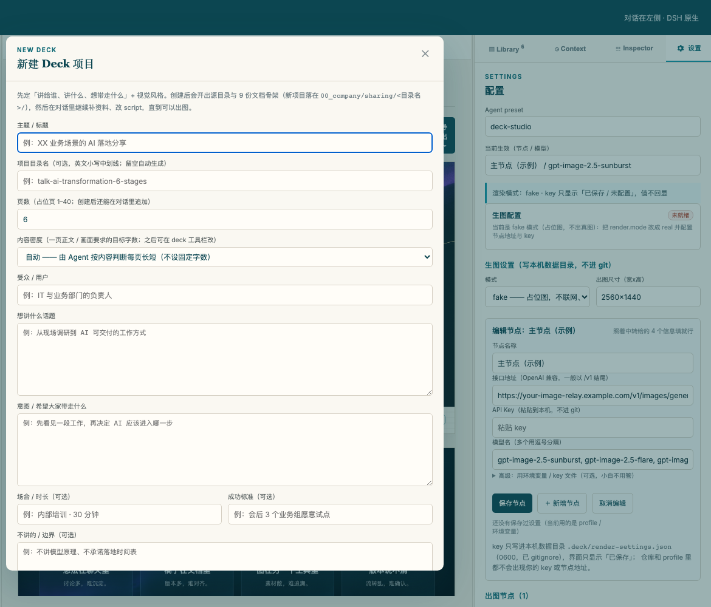
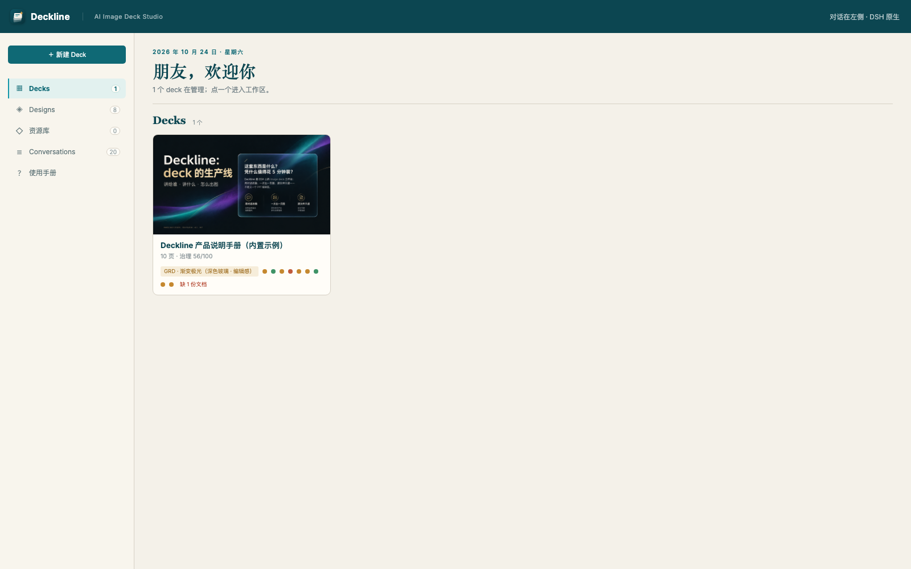
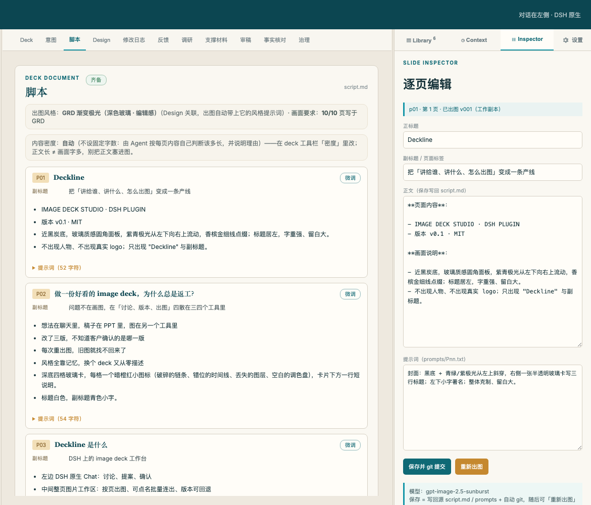
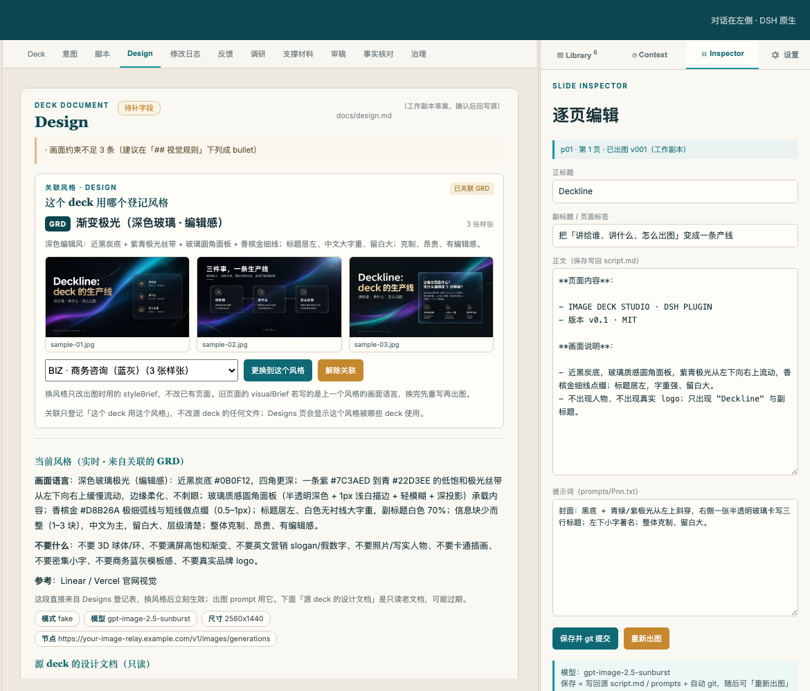
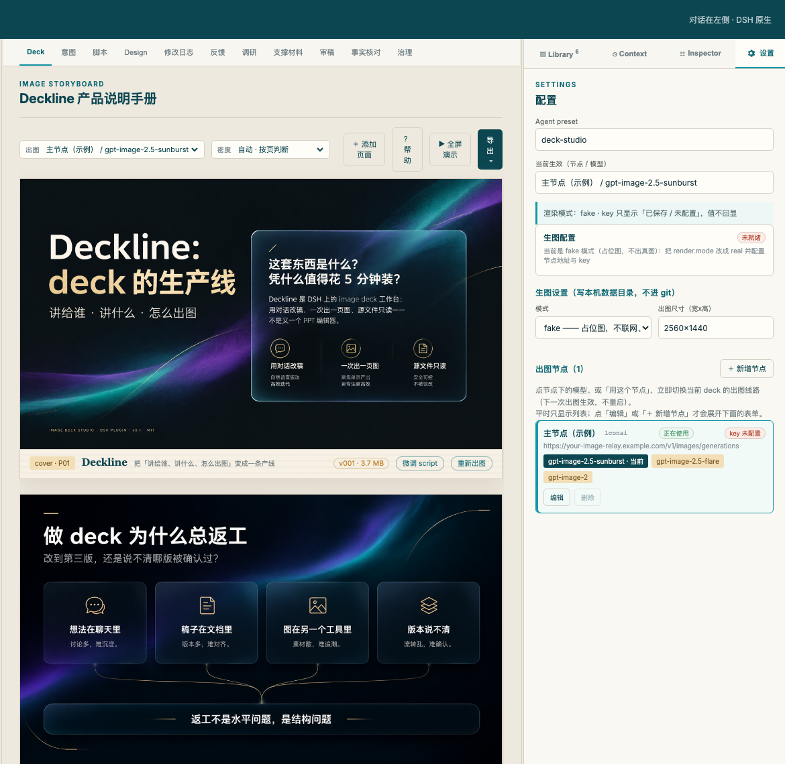
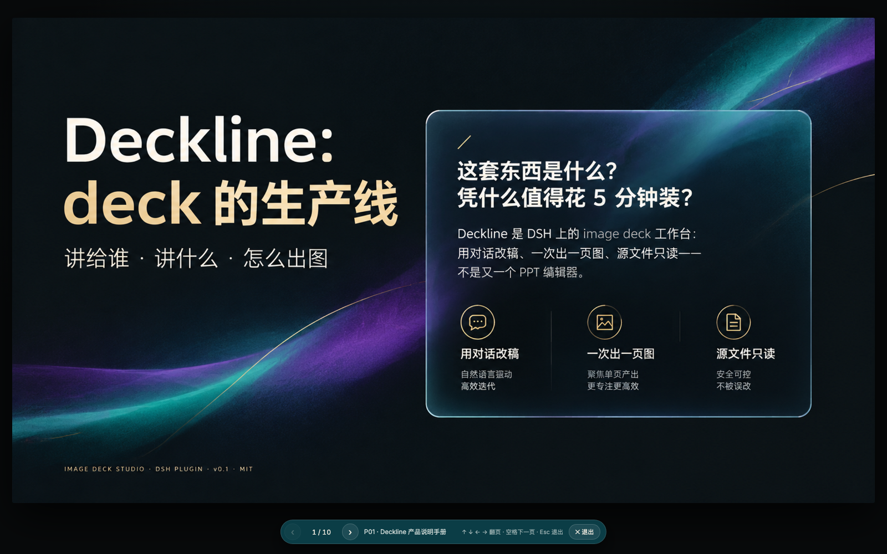
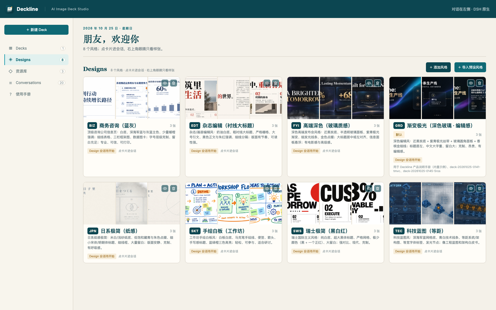
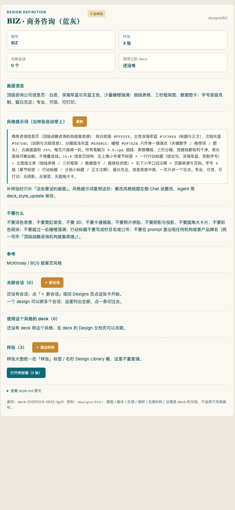

# Deckline · DSH image deck 工作台

简体中文 · [English](README.en.md)

**Deckline** 是 DeepSeek Harness（DSH）的 image deck（整页图片幻灯片）工作台插件：
左边 DSH 原生 Chat、中间 deck 工作区、右边资料库 / 设计风格 / 资源库 / 会话。
它把「讲给谁、讲什么、怎么出图」做成一条可追踪的产线，而不是又一个 PPT 编辑器。

- 对话在 Chat 里继续，deck 的改动有 script / diff / revision / 治理文档撑底；
- 出图**以页为单位**（工具一次一页），点名多页 / 整份时可连续出；每页保留 prompt、图片、版本、QA 和事件；
- **修图（以图生图）**：`deck_image_edit` 拿已有图当底图只改点名部分（去水印 / 改标题 / 删元素），出新版本不覆盖旧图。
- **直接播放**：工作台一键全屏演示，方向键翻页、Esc 退出，不必先导出 PPT；
- **8 个内置风格模板 + 模板管理**：预览样张、创建自己的风格、补充参考图、在不同 deck 间复用；
- **资料多也能读**：≥5 份参考资料时先规划调研批次、逐批读摘要，可引用事实随时落调研台账（不一次读完占满上下文）；
- **数据位置可配置**：运行数据默认落在 `$DSH_HOME/deckline`（通常 `~/.dsh/deckline`）；受控源 deck 只读，本机新建 deck 在用户确认后可回写其源文件。



> **每个按钮做什么？** 见 [使用手册（docs/manual.md）](docs/manual.md) / [English manual](docs/manual.en.md)——
> 按界面区域逐张带编号截图说明（1/2/3 标在控件上），包含全屏演示、新建弹窗、页面编辑、导出、生图设置与项目规则。
> 截图来自内置示例 deck（`samples/deckline-intro`）。
> 示例 deck（用项目本身跑通流程）见 [docs/sample-deck.md](docs/sample-deck.md)。

## 5 分钟安装

前置：Node.js `^22.19 或 ≥24`、pnpm 10+、DSH `≥ 0.2.1-rc.2 < 0.3`（`npm i -g @deepseek-ai/dsh`；本版已验证 0.2.1-rc.2，见 [docs/compat.md](docs/compat.md)）。

```sh
# 1) 建一个 deckline profile
dsh --profile deckline --from-default-profile web

# 2) 安装插件（直发 npm 包，无 scope）
dsh plugin --profile deckline add dsh-plugin-deck-studio@0.2.11
#   git 方式：dsh plugin --profile deckline add "github:yuna78/dsh-deck-studio#path:/plugin/deck-studio"
#   本地开发：dsh plugin --profile deckline add "$PWD/plugin/deck-studio"

# 3) 启动
dsh --profile deckline --port 13090
```

> 第 1 步不能省：`deckline` profile 不会自动创建，直接启动会报 `profile "deckline" does not exist`。
> 3080 是默认 `web` profile、13090 是 `deckline` profile；**换端口不改数据，换 `dataRoot` 才改数据**（见 [docs/install.md](docs/install.md) §3）。

浏览器打开终端打印的 `http://127.0.0.1:13090/?token=…` —— 进去就是**工作台主页**（Decks / Designs / 资源库 / Conversations）；
顶栏右上角有三个常驻按钮：**⚙ 设置**（出图节点 / 模型 / 尺寸）、**↻ 更新**（点了查 npm 最新版，有新版弹确认直接更新，重启 DSH 生效）、**GitHub**（去仓库提建议 / 报问题）；
首页左栏底部还有一个常驻的 **关于** 入口（显示当前版本，有新版会亮小圆点）：一页里从上到下是作者、微信公众号（二维码）、版本与更新、开源地址与反馈、其他开源项目；
点一个 deck 进入**左中右三栏**：左栏 DSH 原生 Chat、中间整页图片 storyboard、右边资料库。

详细步骤、git 子目录安装、排障见 **[docs/install.md](docs/install.md)**。

## 界面一览

| 首页：deck / 风格 / 资源 / 会话 | 脚本：逐页 script 与提案 |
|---|---|
|  |  |

| 设计风格：关联 / 样张 / 换绑 | 设置：出图节点、模型、key 来源、尺寸 |
|---|---|
|  |  |

## 一键播放：写完就能讲

在 deck 工作台点击 **「▶ 全屏演示」**，直接播放已有的整页图片幻灯片，无需先导出：

- **← / ↑** 上一页，**→ / ↓** 下一页；笔记本没有 PageUp / PageDown 也能用。
- **Esc** 退出，底部显示当前页码，支持点击上一页 / 下一页。
- 播放不会调用生图、修改文案或覆盖图片；需要分享文件时再导出 PDF / PPTX。



## 内置模板与模板管理：Designs 风格库

这里的**模板是可复用的视觉风格（Design）**，包含画面语言、风格提示词和样张，不是可编辑的 PPT 母版或固定布局。
插件自带 **8 套模板、每套 3 张样张**：商务咨询、高端深色、日系极简、杂志编辑、科技蓝图、手绘白板、瑞士极简、渐变极光。
首次启动自动导入；已有库也可点 **「＋ 导入预设风格」** 补齐，已存在的缩写会跳过。



**不只是选一个模板，还能长期维护自己的风格库：**

- **预览和选择**：点卡片右上角眼睛查看样张；新建 deck 时选风格，已有 deck 可在 Design 页关联或更换。
- **创建自己的模板**：在 Designs 点「＋ 添加风格」，填写名称、缩写和画面描述，粘贴 / 拖入 / 上传样张。
- **管理定义与样张**：点卡片进入独立风格画布；查看、复制风格提示词，在 Chat 中修改风格定义；添加参考样张或让 Agent 生成新样张。
- **跨 deck 复用**：查看使用该风格的 deck 和关联会话；误建的风格可从卡片删除。
- 更换关联不会自动重绘旧页，旧图片仍保留；新出图使用当前关联的风格。



完整风格目录与自定义方式见 [风格指南](docs/styles.md)，逐步操作见 [使用手册](docs/manual.md)。

## 配置

两种方式，任选：

1. **界面里配**（推荐，保存即生效、不用重启）：进任意 deck → 右栏 **设置** → 填 endpoint / 模型 /
   key 环境变量名（或 key 文件路径）/ 尺寸 → **保存并生效**。写在 `<dataRoot>/render-settings.json`
   （本机数据目录，已 gitignore，0600）：节点可直存 key（界面只显示「已保存」、不回显），也可用变量名 / key 文件。
2. **profile patch**（适合团队统一分发）：`~/.dsh/profiles/deckline/cordis.patch.yml`。
可直接抄仓库里的 [`plugin/deck-studio/cordis.example.yml`](plugin/deck-studio/cordis.example.yml)。

```yaml
- id: deck-studio
  name: 'dsh-plugin-deck-studio'
  config:
    displayName: 'Deckline'
    hideShellSidebar: true        # 可选：这个 profile 里默认收起 DSH 左侧栏（默认 false）
    userName: '你的名字'
    projectsRoot: '/absolute/path/to/your/decks'     # 新建 deck 源文件的落盘根
    # workspacePath: '/absolute/path/to/your/workspace' # 会话绑定的 DSH 工作区（与保存位置无关）
    decks:                                            # 只读引用的 deck 源
      - id: my-deck
        label: '我的 deck'
        sourceRoot: '/absolute/path/to/my-deck'
```

### 生图 key

Deckline 默认 **fake 模式**（占位图，不联网），体验流程不需要 key。
要出真图，配一个 OpenAI 兼容的 `/v1/images/generations` 节点：

```yaml
    render:
      mode: real
      size: '2560x1440'
      default: 'main/gpt-image-2.5-sunburst'
      nodes:
        - id: main
          name: '主节点'
          endpoint: 'https://your-image-relay.example.com/v1/images/generations'
          apiKeyEnv: 'DSH_DECK_IMAGE_API_KEY'        # 或者 apiKeyFile: '~/.keys/image.env'
          models: ['gpt-image-2.5-sunburst', 'gpt-image-2']
```

```sh
export DSH_DECK_IMAGE_API_KEY="sk-…"   # key 只放环境变量 / 本机 key 文件，永不进仓库
```

工作台「设置」面板会显示节点与 **key 是否配置**（只显示布尔值，不回显 key）。
设置页保存过的值优先于 profile（`<dataRoot>/render-settings.json` 覆盖 `config.render`）。

## 用起来

### 已有 deck

首页 **Decks** 点卡片进入工作区：左边和 Agent 讨论，右边按文档 tab 看意图 / 脚本 / Design /
修改日志 / 反馈 / 调研 / 支撑材料 / 治理；出图按页、可点名批量连出。

### 新建 deck

左下 **＋ 新建 Deck**：填主题 / 受众 / 话题 / 意图 + 选风格，建好源目录与 9 份文档骨架，
然后在 Chat 里继续补资料、改 script。

### 加自己的设计风格（可以贴图）

Designs 页 **＋ 添加风格** → 填名称 / 缩写 / 画面描述 → **在「样张图片」区直接 ⌘V 粘贴、
拖入或点选文件**（png/jpg/webp，多张）→ 创建。会同时建好风格、0 页空白画布和一个 design 会话。

已有风格补样张：点风格卡右上角 **眼睛** → 预览弹层底部「＋ 添加样张」。
也可以直接把图片放进 `designs/<ABBR>/` 目录（见 [docs/install.md](docs/install.md) 第 5 节）。

### 更新插件 / 提建议

装好之后不用记命令：工作台顶栏右侧三个按钮——**⚙** 直接切到右栏设置页，**↻ v0.2.11** 点一下就去 npm 查最新版，**GitHub** 去仓库提建议。
首页左栏的 **关于** 页里也有同样入口（检查新版本 / 开源地址 / 提交建议），另有公众号二维码和其他开源项目。

- 有新版：弹一句「当前 vX → vY」，点「更新」直接跑 `dsh plugin add`，跑完提示重启 DSH（更新写在 profile 里，运行中的进程还是旧版本）。
- 已是最新：提示「已是最新版本 vX」。
- 本机 `link:` / `file:` 开发安装：只解释「更新走仓库」，**不会**把本地链接换成 registry 包（避免顶掉你正在改的代码）。

旁边的 **GitHub** 按钮直接打开仓库的「新建 issue」页。命令行等价写法：

```sh
dsh plugin --profile deckline add dsh-plugin-deck-studio@latest
```

### 9 个预设风格（随插件分发）

Designs 页 **＋ 导入预设风格** 一键导入（幂等，已存在的缩写自动跳过）：

| 缩写 | 风格 | 适合 |
|---|---|---|
| BIZ | 商务咨询（蓝灰） | 提案 / 汇报 / 数据页 |
| FYI | 高端深色（玻璃质感） | 发布会 / keynote / 高端品牌 |
| JPN | 日系极简（纸感） | 文化 / 培训 / 安静叙事 |
| EDT | 杂志编辑（衬线大标题） | 品牌故事 / 长文信息页 |
| TEC | 科技蓝图（等距） | 架构 / 技术方案 |
| SKT | 手绘白板（工作坊） | 研讨 / 共创 / 培训 |
| SWS | 瑞士极简（黑白红） | 极简宣言 / 大字报 |
| GRD | 渐变极光（现代 SaaS） | 产品发布 / 互联网风格 |
| DSA | 深海琥珀（深青 + 香槟金细线） | 高端分享 / 深色叙事 / 衬线大标题 |

每个预设都带 3 张真实基线样张（封面 / 信息页 / 数据页，`plugin/deck-studio/seeds/samples/`），风格定义在
`plugin/deck-studio/seeds/styles/*.json`。目录与自定义方法见 [docs/styles.md](docs/styles.md)。

## 仓库结构

```
plugin/deck-studio/        # DSH 插件（npm 包内容，可直接安装）
  seeds/styles/*.json      # 预设风格定义
  seeds/samples/*.jpg      # 预设风格基线样张（每个风格 3 张）
assets/logo/               # Deckline logo（svg + png）
samples/deckline-intro/    # 示例 deck 源：Deckline 产品说明手册（intent / script / prompts）
docs/                      # 安装 / 使用手册（中英）/ 风格 / 示例 deck / 截图
  assets/screenshots/      # README 与手册用截图
market-index.json          # 插件市场索引（DSH 发现页添加索引源）
```

## 示例 deck：用 Deckline 讲 Deckline

[`samples/deckline-intro/`](samples/deckline-intro/) 是一份 10 页的《Deckline 产品说明手册》
deck 源（intent / script / 画面说明），随仓库分发，可直接拿来跑通整条流程：
新建 deck → Agent 起草 script → 确认 → 逐页出图 → 导出。

照着 [docs/sample-deck.md](docs/sample-deck.md) 操作：**内容是在首页「＋ 新建 Deck」弹窗里填的**，
「参考资料」用 [samples/deckline-intro/materials.md](samples/deckline-intro/materials.md) 里的真材料清单
（README / 产品文档 / 代码路径 / 预设风格与样张 / logo / 产品截图，逐份写清用在哪一页），
不是让 Agent 凭空编。落不了地时也可以让 Agent 先读这个 materials.md 再写。

## 状态

- 当前版本：`v0.2.11`（可用，API 仍可能小改）
- License：**MIT**（见 [LICENSE](LICENSE)）

## License

MIT © 2026 Yuna（Deckline）。见 [LICENSE](LICENSE)。
