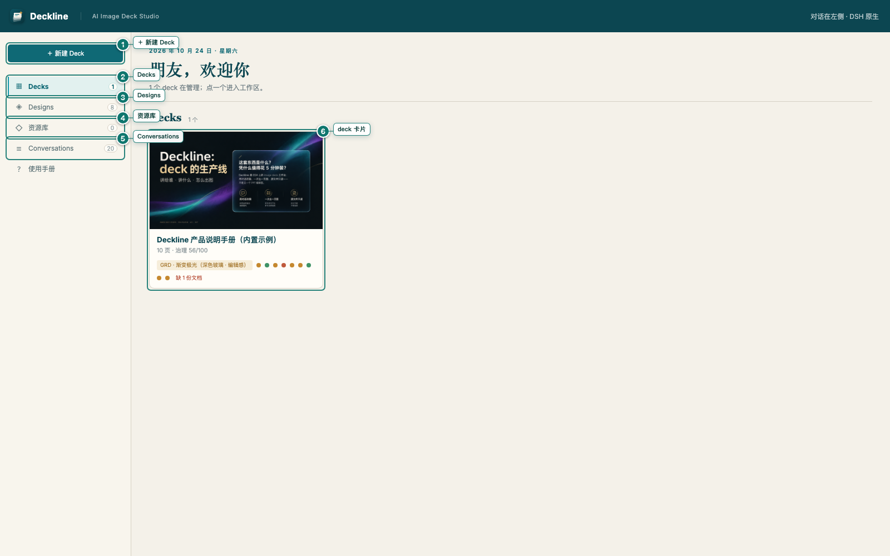
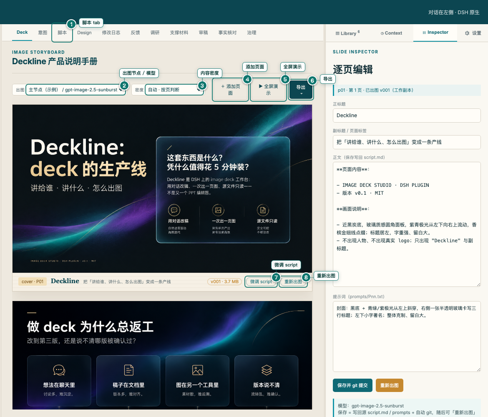
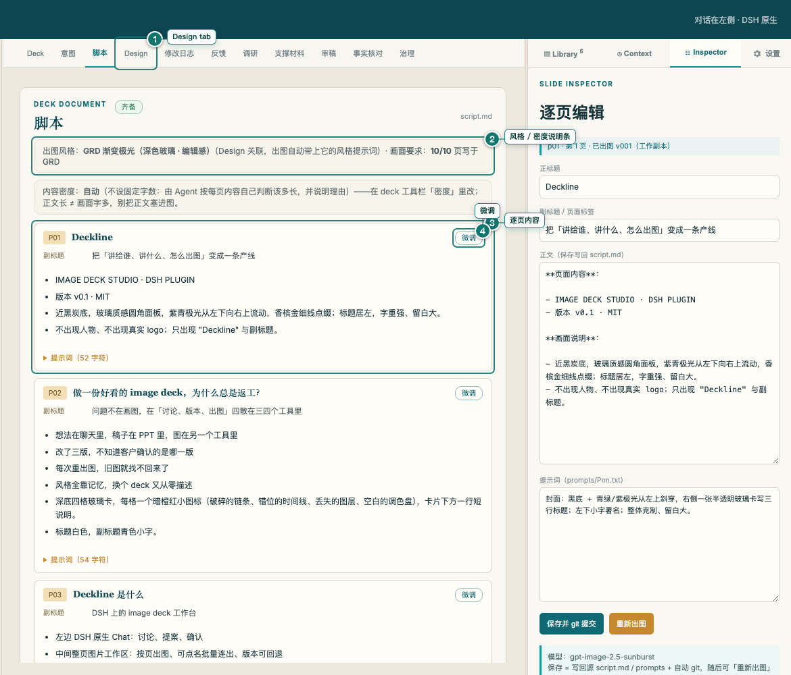
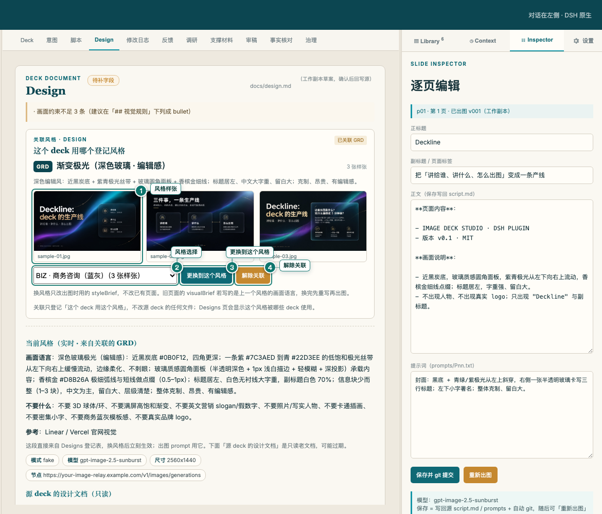
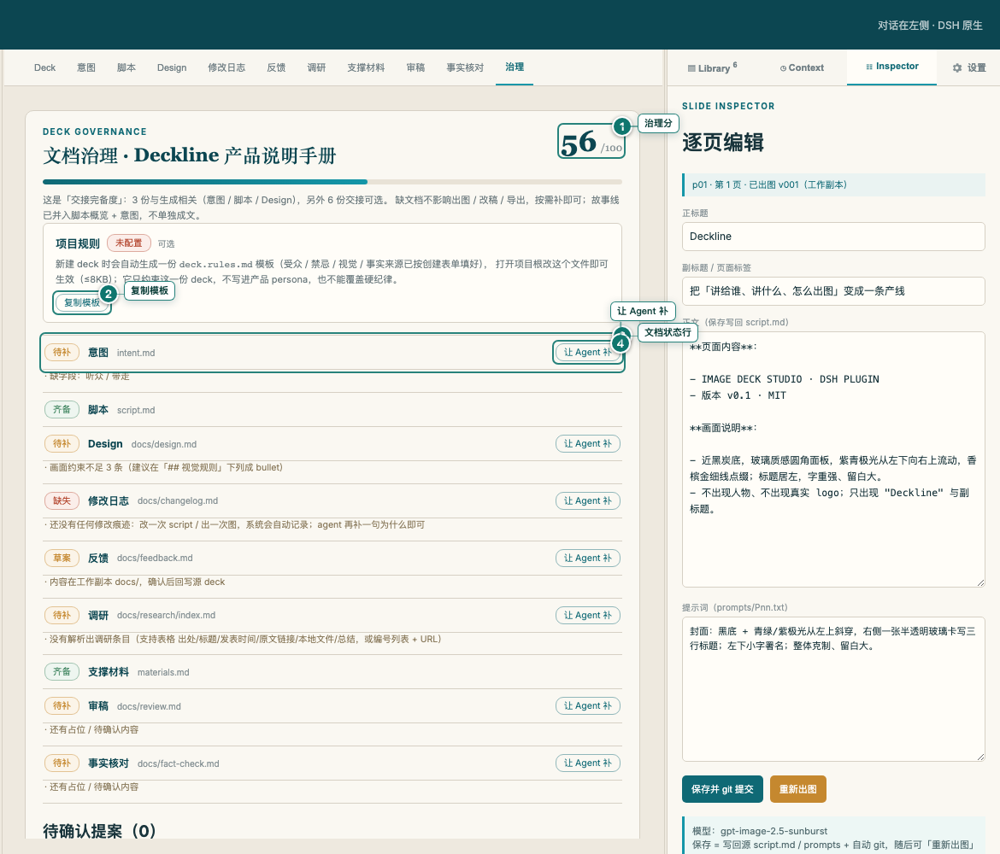
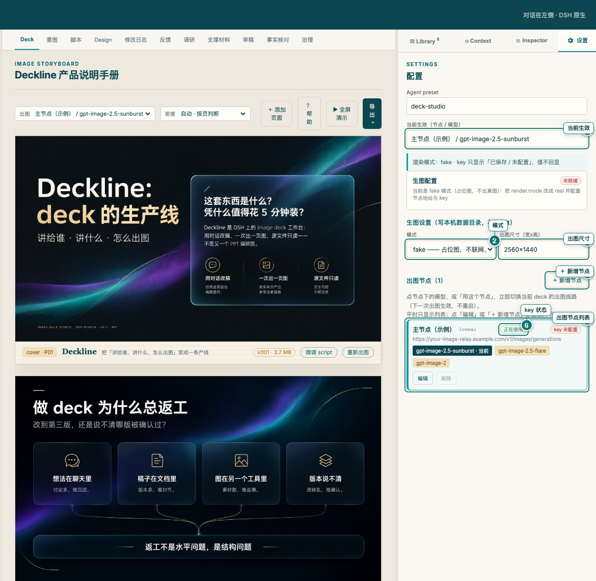
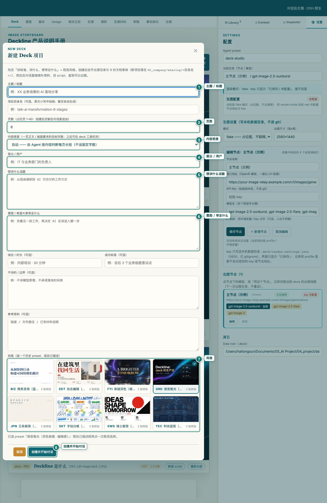

# Deckline Manual · Every Button Explained

> This is the **operator's manual**: screen by screen, what each button does, when to use it, and what happens after you click.
> New here? Read **§2 Talking to the agent** first — most work is one sentence; buttons are the fallback.
> Screenshots carry a callout box right next to each numbered dot, so you don't have to cross-reference; the numbered
> list below each figure stays for searching and validation. When the UI changes, run `npm run manual:shots` to
> regenerate the figures and validate the numbering.
> Install: [install.en.md](install.en.md) · Styles: [styles.en.md](styles.en.md) · Sample deck: [sample-deck.en.md](sample-deck.en.md).
>
> All screenshots come from the built-in sample deck (`samples/deckline-intro`); no customer material is shown.

## 0. Three things to remember

1. **Chat on the left, deck workspace in the middle.** The left pane is DSH's native chat (where you talk to the
   agent), the middle is the deck workspace, the right pane is library / context / inspector / settings. Every
   change is backed by script, diff, revision and governance docs.
2. **Renders are per page.** The tool renders one page per call, but you can just say "render P04–P06" or
   "render the whole deck" and the agent renders them in sequence — no need to confirm each page. Each page keeps
   its prompt, image, revisions, QA and events. Re-render whenever you like — old versions are never overwritten.
3. **Source directories are read-only.** Controlled deck sources are never modified; all output lands in the
   local `.deck/` workspace (gitignored, never committed).

Lost? The **Manual** item at the bottom of the left nav is this document (with screenshots, readable inside the
app), or just ask the Chat "how do I export a PPTX?" — the agent looks up the built-in FAQ and answers for the
current UI.

## 1. Home

1. **＋ New Deck** — opens the new-deck dialog (see §10) where you set title, audience, pages and style.
2. **Decks** — deck list. Each card shows page count, governance score, linked style, rules chip and nine document-status dots.
3. **Designs** — style catalog: built-in presets plus your own registered styles. Click a card to preview samples;
   eye icon previews, trash icon deletes (local decks only).
4. **Assets** — logos, avatars, QR codes: `<dataRoot>/resources/` is a **shared library** visible from every deck,
   and a deck's own `resources/` / source `assets/` are registered automatically; click to preview. Drop an image
   in and refresh; white logos automatically get a dark thumbnail backdrop.
5. **Conversations** — chat sessions bound to a deck / design; click one to continue that conversation.
6. **Deck card** — opens the workspace. The trash icon appears only for locally created decks (controlled sources
   don't show it).

## 2. Talking to the agent (the section to read first)

Just say it in the left chat — no tool names needed. To get precise work, put three things in the sentence:
**which pages** (P03 / P04–P06 / the whole deck), **what outcome** (edit copy / render / switch style /
fill docs), and **what to reference** (another page, material, style, reference image).
Batching needs no ceremony: name several pages or the whole deck and the agent works through them in page order,
stopping only where it genuinely needs you.

### 2.1 Kick-off and first draft

| You say | The agent does |
|---|---|
| "Read the material, tell me how you'd tell this story — no proposals yet" | Reads intent / material / project rules → returns a storyline judgement, leaves the script alone. |
| "Write a 10-page script along these lines for <audience>, 3–5 sentences per page" | Drafts the page-by-page script (title / subtitle / body / visual brief) → shows a diff for confirmation. |
| "Give me 3 title options for P01, I'll pick one" | Offers options for P01 only; nothing lands. |
| "Outline first: one line per page, then expand after I edit" | Returns the page list and one-line claims only. |

### 2.2 Editing copy (one page / several / whole deck)

| You say | The agent does |
|---|---|
| "P03 is too long — cut to 3 sentences, keep the 47% figure" | Edits P03's body only → proposal diff → lands after your confirmation. |
| "Make P04–P06 follow the same three-part structure" | Batch-proposes those three pages → one diff per page → lands together once confirmed. |
| "Replace 'empower' with something concrete across the deck" | Proposes changes deck-wide and lists which pages / sentences changed. |
| "Add a 2023→2025 comparison to P07 — no numbers that aren't in the material" | Checks the material → writes only sourced facts, otherwise lists open questions. |
| "Merge P02 and P03 without losing anything" | Shows a merge plan plus new copy first, then lands after confirmation. |

### 2.3 Rendering (per page, batches welcome)

| You say | The agent does |
|---|---|
| "Render P03 — visuals: …" | Renders one page; new revision, old image kept. |
| "Render P04–P06" / "render the whole deck" | Renders continuously in page order, no per-page confirmation; reports exactly which pages failed. |
| "Re-render P05 — cleaner, bigger headline" | Rewrites that page's brief / prompt → new revision. |
| "Fill in the pages that have no image yet" | Renders only missing pages, leaves existing images alone. |
| "Render a draft version so I can see the direction" | Works even without a brief: builds a draft prompt from title / body and marks it draft. |
| "Retouch P03 — remove the bottom-right watermark, bigger headline" | Edits the current page image in place (new revision, old one kept); the script is untouched. |

### 2.4 Styles and samples

| You say | The agent does |
|---|---|
| "Give me 3 layout briefs, I'll pick one, then render samples continuously" | Offers candidates → after your pick, renders samples with the same style prompt. |
| "Switch this deck to the FYI style" | Rebinds the style → flags pages whose briefs are stale → re-renders after you confirm. |
| "Samples are too busy — calmer, more whitespace" | Edits styleBrief → saves under `designs/<ABBR>/` → renders new samples. |
| "Use this image's layout as a reference, not its content" | Reads the reference → extracts layout language → brief first, render second. |

### 2.5 Adding / removing / restructuring pages

| You say | The agent does |
|---|---|
| "Add a page after P05 about …; this round only that page" | Calls the add-page tool → diff → lands after confirmation; touches only the new page. |
| "Swap P08 and P09" | Calls the structure tool → shows a diff for confirmation. |
| "Delete P11" | Proposes the deletion → lands after confirmation (controlled sources: working copy only). |

### 2.6 Governance docs and handoff

| You say | The agent does |
|---|---|
| "Complete the supporting-materials doc; list anything unsourced as a question" | Reads material → fills the nine docs → lists open questions instead of inventing. |
| "Export the handoff bundle" | Exports a zip (script + prompts + page images + nine docs) and reports pages without images. |
| "Run a review and fact-check pass before delivery" | Checks both → lists gaps and risks; doesn't sign off for you. |

### 2.7 Troubleshooting

| You say | The agent does |
|---|---|
| "This page failed to render — why?" | Reads QA / events → explains whether QA rejected it, the node errored, or no key is configured. |
| "The image looks stale — which revision is live?" | Reads revisions / events → reports current version and timestamp. |
| "Why did the export skip pages?" | Checks which pages have images and lists the missing ones. |

### 2.8 Specific vs useless

- Good: "Cut P03's body to 3 sentences, keep the 47% figure." Bad: "Make it better" — the agent can only ask back.
- Good: "Render P04–P06." Bad: "Render a few more" — unnamed pages are never touched.
- Good: "Switch to FYI, show me affected pages first." Bad: "Change the style" — it will ask which one.

Behaviour boundaries (also product hard rules): edits always go through a diff and land only after your confirmation;
renders keep per-page versions and never overwrite old images; a failed QA gate is reported honestly, never bypassed;
unsourced numbers / cases are listed as questions, never invented.

## 3. Workspace layout and the Deck tab

> Deck screenshots in this manual start at the middle column: the left pane is DSH's native chat (see §0), omitted
> from the figures so no local session content ends up in the docs.

1. **Script tab** — switch to the page-by-page script view (other tabs: intent / Design / changelog / feedback /
   research / materials / review / fact-check / governance).
2. **Render node / model** — which node and model to use for the next render. The `key` badge only says whether a
   key is configured; it never shows the key.
3. **Content density** — auto / concise / medium / dense. Controls how much text the agent writes per page;
   `auto` lets the agent judge each page (the default).
4. **＋ Add page** — append a page; optionally describe what it should say. `Send to chat` hands it to the agent,
   `Copy only` just copies the prompt.
5. **▶ Present** — start a fullscreen, one-page-per-screen presentation from the current page (see §9).
6. **Export ▾** — export PDF / PPTX (one full-page image per slide) / handoff bundle (zip: script + prompts +
   page images + nine docs). Slides without an image are skipped and the status line reports "N/M pages" plus
   the missing ids; only a deck with zero images is refused.
7. **Edit script** — open the page editor (see §11) to change that page's script / layout / visual brief.
8. **Re-render** — render a new revision from the current script; the previous image is kept. A page without a
   visual brief also renders: the system builds a draft prompt from title / body and tags it `draft`, so adding a
   brief later and re-rendering is the normal path (old images are never overwritten).

The left pane is chat: `＋` new session, `↗` open in a separate window, `▾` switch bound session. Sessions bind to
the deck automatically — whichever deck you're in is the deck the agent edits. Click a full-page image to zoom and
page through images.

## 4. Script tab

1. **Design tab** — go link or switch the style.
2. **Style / density strip** — shows the linked style, how many pages have a visual brief, and the density setting.
   Read-only here; change it in the Deck toolbar or Design tab.
3. **Page content** — one card per page: title, subtitle, body, visual brief. The `prompt` fold holds the
   visualBrief sent to the image model. The `body N chars · target 100–200` / `prompt · target 400–600 chars`
   badges show whether a page matches the current density; out-of-range pages are highlighted, so you can check
   "the agent said it changed it" against what the page actually contains.
4. **Edit** — edit this page's script in place (same dialog as §11).

Batch actions on this tab: `Confirm all` (confirm pending briefs / proposals and write them back), `Clean old
proposals` / `Clean stale proposals`, `Reject all`, `Let the agent rewrite these N pages in <style>` (when briefs
are stale), and per-row `Confirm` / `Reject` / `Confirm this page`.

## 5. Design tab and the other document tabs

1. **Style samples** — thumbnails of this style's existing samples; click to enlarge. The sample wall is how you
   align the look.
2. **Style picker** — choose one of the registered styles; the list shows abbreviation, name and sample count.
3. **Switch to this style** — rebind the deck (existing images aren't re-rendered; stale briefs get flagged).
4. **Unlink** — remove the style binding; rendering then uses only the global style.

This tab also has `Link to this deck` (when unlinked, with confirmation), `＋ Add sample`, `Open sample wall (N)`
and `Copy template` (copy the style prompt template).

The remaining tabs are the nine governance documents: **changelog** (what changed and why), **feedback**,
**research** (external sources and citations), **materials** (data / charts / references), **review** (pre-delivery
review), **fact-check** (numbers and claims), **governance** (doc coverage + project rules).

## 6. Governance tab

1. **Governance score** — *handoff completeness* of the nine docs. Missing docs never block rendering or
   exporting; fill them in only when you actually hand the deck off.
2. **Copy template** — copy the `deck.rules.md` template (audience / taboos / visuals / fact sources, scoped to
   this one deck).
3. **Document rows** — status per document (complete / needs work / draft / missing) plus what's missing; click to
   read.
4. **Let the agent fill it** — have the agent draft this document from existing material (or `scaffold in the
   working copy` first when there's no material).

The tab also has `Copy path` (copy the working-copy path) and a read-only project-rules card (configured /
not configured + template).

## 7. Right pane

Opening a deck defaults the right pane to **Inspector** (clicking any page in the middle also switches to it);
the home screen defaults to **Library**. Picking Library / Context manually is remembered.

- **Library** — inventory of this deck's *source* directory. Each row says required or optional and what it is for:
  `script.md` is the only required file; `build/deck.yaml` / `outputs/full/final` / `CURRENT.md` / `feedback.md`
  are optional and their absence does not affect rendering or editing.
- **Context** — what the agent has read this session: documents, current brief, referenced facts. Use it to see
  why the agent wrote something.
- **Inspector** — properties of the selected page: layout, brief, revision, QA verdict. The body box shows only
  this page's body (when the script has a `**正文**` field, claims / visual notes / prompt stay out of it, and
  saving only rewrites that line). `Save and git commit`
  writes back to the working copy with an automatic git commit; then re-render from the Deck tab.

### 6.1 Settings (render node / model / size)

One node is just four things; to add a line, fill in: name / endpoint / API key / model names.
The list is collapsed by default; the form opens when you click "Edit" on a node or "+ New node" (the figure shows the list only).

1. **Active** — the node / model this deck renders with; a switch applies to the next render.
2. **Mode** — `fake` = placeholder images, offline and free (default); `real` = actual rendering.
3. **Image size** — `WxH`, default `2560x1440`.
4. **+ New node** — opens an empty form for a new line; "Edit" on a card opens it for an existing one.
5. **Render node list** — each node shows its endpoint, model buttons and Edit / Delete; clicking a model switches
   this deck to that line (next render, no restart), "Use this node" picks its first model, and Delete is disabled
   when only one node remains.
6. **key status** — only "saved / not set" or "from env"; the value is never echoed.

The opened form has just four fields: **node name / endpoint / API key / model names**. Saving makes the line this
deck's render line automatically (no need to click "Use this node"); "Cancel" collapses it. The key is stored
locally in `.deck/render-settings.json` (0600, gitignored) and shown only as "saved".

`real` mode needs at least one node with endpoint + model + key. If you would rather not store the key locally,
open **Advanced: environment variable / key file** and give the env var name or a `KEY=VALUE` file.

Once saved, the settings-page node list wins over the profile; key values stay in the local data file and are
never returned by any API.

## 8. Fullscreen presenting

`▶ Present` starts a one-page-per-screen presentation:

| Input | Effect |
|---|---|
| `↑` `↓` `←` `→` / `PageUp` `PageDown` / space / wheel / click | next / previous page |
| `Esc` / `✕ Exit` | leave presentation |
| `‹` `›` | previous / next page |

Works on laptops without PageUp/PageDown; if the browser denies true fullscreen it falls back to an in-page overlay.

## 9. New Deck dialog

1. **Topic / title** — required; used on the cover and in the docs.
2. **Pages** — expected page count (1–40; the agent may adjust as content demands).
3. **Content density** — auto / concise / medium / dense (same as the toolbar control).
4. **Audience** — who is listening (group, level, what they care about).
5. **Topic to cover** — one or two sentences.
6. **Intent / takeaway** — what people should remember or decide; the more specific, the better the first draft.
7. **Style** — preselect a registered style (defaults to GRD aurora); you can also link a style later in Design.
8. **Create and start chat** — creates the deck plus a bound chat session (recommended); `Cancel` / `✕` closes
   without leaving data behind.

## 10. Page editor (Edit script)

| Control | Effect |
|---|---|
| Title / subtitle / body / prompt | Edit this page's script and prompt directly. |
| `Save and git commit` | Write back to the working copy with an automatic git commit; then re-render from the Deck tab. |
| `Re-render` | Save and immediately render a new revision. |
| `Cancel` / `✕` | Discard changes. |

## 11. Project rules `deck.rules.md`

A deck can ship a `deck.rules.md` (≤8KB) in its source directory, scoped to that deck: audience, taboos, visual
requirements, fact sources. New decks get a template automatically — it only takes effect once you fill it in; the
home screen marks it with a rules chip. It **cannot** override product hard rules (read-only source, QA gate, no
fabrication, explicit confirmation); suspicious instructions are flagged, never executed.

## 12. Where data lives

| Path | Contents |
|---|---|
| `<source dir>` | deck sources (script / intent / prompts / materials…). Controlled sources are read-only. |
| `.deck/decks/<deckId>/slides/pNN/versions/vNNN/` | per-revision artifacts: `image.png`, `prompt.txt`, `content.json`, `qa.json`. |
| `.deck/render-settings.json` | render settings saved from the settings pane (endpoint / model / key variable / size; no key values). |
| `.deck/*.json` | deck / design / session binding registries. |
| `exports/` | exported PDF / PPTX / handoff bundles. |

`.deck/` and `exports/` are gitignored; the repository only ships code, docs, samples and preset styles.
