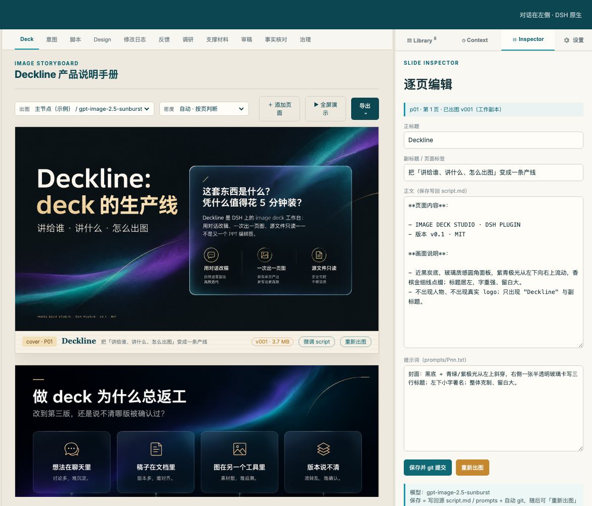

# Deckline · 用对话制作整页图片幻灯片

**从「讲给谁、讲什么」到脚本、逐页出图、版本与交付，在 DSH 里完成。**

Deckline 是 DeepSeek Harness（DSH）的 **image deck 工作台插件**，不是独立应用，也不是可编辑图层的 PPT 编辑器。对话留在 DSH 原生 Chat；工作台负责脚本、图片、设计风格、版本和资料。

[安装与配置](../../docs/install.md) · [使用手册](../../docs/manual.md) · [示例 deck](../../samples/deckline-intro) · [English overview](../../README.en.md)

## 先看看它怎么工作



*上图为内置公开示例：中间浏览整页图片，右侧查看与修改这一页的正文、画面要求和提示词。截图展示对应拍摄版本，具体控件以当前版本为准。*

### 从想法到可交付的 deck

| 你要做什么 | Deckline 提供什么 |
|---|---|
| 把想法讲清楚 | 从受众、意图与参考资料开始，组织故事线和逐页脚本 |
| 做出整页画面 | 按页生成图片；点名多页时可连续出图，每页保留 prompt 与版本 |
| 调整内容和画面 | 在 Chat 里改稿，查看提案；已有图片可做局部修图，生成新版本而不覆盖旧图 |
| 统一视觉风格 | 内置风格与样张预览，也可创建自己的 Design、添加参考图并跨 deck 复用 |
| 检查再交付 | 听众评审、资料与审稿文档；直接播放，或导出 PDF / PPTX / 交接包 |

> **导出的 PPTX 每页是一张整页图片，不是可逐项编辑的文本和图表。** 真实出图需要自行配置兼容的 image API；默认 fake 模式用于体验流程。

## 写完就能讲：直接全屏播放

在工作台点击「全屏演示」，用方向键翻页、Esc 退出；不必为了预览先导出文件。


## Designs：不只选风格，还能维护自己的风格库

预览内置样张、为 deck 选择风格；也可以创建自己的风格，管理画面描述、参考图和样张。这里的 Design 是可复用的视觉定义，**不是固定布局的 PPT 母版**。


更多画面与流程见 [仓库首页](../../README.md)、[风格指南](../../docs/styles.md) 和 [完整示例](../../docs/sample-deck.md)。以上图片均来自公开示例或演示数据。

## 安装

前置：Node.js `^22.19 或 ≥24`、pnpm 10+、DSH `≥0.2.1-rc.2 <0.3`。详细兼容范围见 [兼容说明](../../docs/compat.md)。

```sh
# 1) 新建一个 profile（基于 DSH 自带 web 模板）
dsh --profile deckline --from-default-profile web

# 2) 安装 npm 最新版；安装后自动注册 bundle
dsh plugin --profile deckline add dsh-plugin-deck-studio@latest

# 国内网络可按需使用镜像，注意镜像版本同步可能有延迟
# npm_config_registry=https://registry.npmmirror.com dsh plugin --profile deckline add dsh-plugin-deck-studio@latest

# 3) 启动，打开终端打印的带 token 链接
dsh --profile deckline --port 13090
```

也可以在 DSH「插件 → 发现」中添加索引源：

```text
https://cdn.jsdelivr.net/gh/yuna78/dsh-deck-studio@main/market-index.json
```

从源码 / Git 安装、Windows、模型与出图配置及排障见 [中文安装指南](../../docs/install.md) / [English installation](../../docs/install.en.md)。升级后重启 DSH；听众审稿由插件内部调用，不需要单独选择审稿 Mode。

## 快速开始

1. 首页点「＋ 新建 Deck」，填写标题、受众和一句话意图，选择视觉风格。
2. 在 Chat 中补充资料、起草故事线与逐页脚本，再按需修改和出图。
3. 默认 fake 模式生成占位图；真实图片请在「设置」配置出图节点 endpoint、模型与 key。
4. 在工作台查看页面和版本，直接全屏演示，或导出文件交付。

出图节点不内置。真实渲染需要配置 OpenAI 兼容的 `/v1/images/generations` 地址。节点 key 保存在本机数据目录的 `render-settings.json`（0600，不回显）；不要将 key 提交到 Git。

## 数据与边界

- 工作副本、图片、版本与事件默认写 `$DSH_HOME/deckline`，可通过 `dataRoot` 覆盖。
- 受控源 deck 的 `sourceRoot` **只读**；本机新建 deck 位于 `projectsRoot` 或 `<dataRoot>/projects/<deckId>/source`，有独立写入流程。
- 每次出图保留版本，旧图片不会因新图生成而被覆盖。
- 这是 DSH 插件，运行时依赖宿主与用户配置的模型服务；不承诺离线真实出图。

## 许可与反馈

MIT © 2026 Yuna (Deckline) · [LICENSE](../../LICENSE)

[报告问题 / 提建议](https://github.com/yuna78/dsh-deck-studio/issues) · [发布记录](https://github.com/yuna78/dsh-deck-studio/releases)
